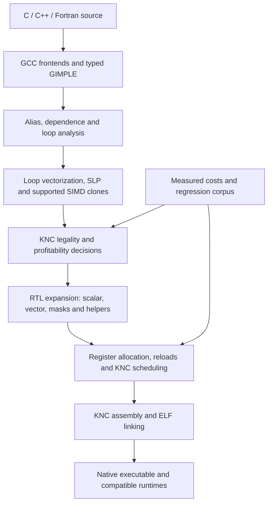

# GCC-KNC: technical research, architecture and implementation strategy

**Research date:** 1 November 2026  
**Target:** Intel Xeon Phi Knights Corner, initially the project's 7120P  
**Languages:** C, C++ and Fortran  
**Status:** Independent research and proposed engineering design. No new compiler, hardware benchmark or acceptance gate is claimed by this report.

## 1. Executive recommendation

Build **a native KNC subtarget in a supported GCC release**, accompanied by a compatible toolchain/sysroot, a small qualified math library, a measured target cost model and application benchmarks. Use the existing GCC 5.1.1 K1OM source as a donor and executable baseline. Preserve the current PhiWeather/PhiChat paths while replacing them incrementally.

The central opportunity is to make optimization decisions while the compiler still knows types, loop structure, dependencies and memory accesses. Generating x87 first and reconstructing that information afterward makes precision selection, vectorization and profitable scheduling unnecessarily difficult. Assembly rewriting remains useful for experiments and differential diagnosis; it should not be the foundation of a general-purpose source compiler.

The compiler must combine three kinds of work:

1. **Generate legal, compact KNC code:** scalar operations, masks, memory accesses, calls, spills and vector instructions must all work together.
2. **Generate profitable code:** choose useful vectorization dimensions, handle short loops cheaply, reuse data, control register pressure and schedule for KNC's execution resources.
3. **Support complete programs:** language runtimes, math, OpenMP, MPI/Fortran boundaries, linking and deployment must work with the card's environment.

Our experience supports this direction, but does not establish a guaranteed speedup. PhiWeather demonstrated large gains from fixing allocator contention and from selected vector kernels, yet broad translated builds regressed. PhiChat demonstrated that data reuse, specialized kernels and workload-specific dispatch can matter more than applying one optimization everywhere. GCC-KNC should automate those mechanisms where their legality and profitability can be established; application-specific scientific and algorithmic decisions remain outside the compiler.

**Recommended starting base:** GCC 16.2, subject to a small cross-build feasibility milestone. GCC currently lists 16.2, 15.3 and 14.4 as supported releases. The project's existing GCC 14.3 generator remains a useful reference, but is not a reason to commit a new long-lived compiler to an older branch. If a concrete host-tool or runtime blocker makes 16.2 disproportionately expensive, record that blocker before selecting 14.4 as a bridge. Calling the project “LTSC” creates a maintenance commitment; it does not make a private target upstream-supported. [GCC release status](https://gcc.gnu.org/).

## 2. Product definition and boundaries

The intended product is a reproducible cross-toolchain that accepts ordinary supported C/C++/Fortran source and emits native KNC Linux executables. Its generality comes from language support and complete lowering, rather than recognizing a fixed list of WRF routines.

“Universal” cannot mean that arbitrary modern x86 intrinsics, operating-system interfaces or GPU programming models work unchanged. A program containing AVX2 intrinsics may need a source portability layer; a program relying on a newer Linux syscall may need a runtime adaptation. Likewise, accepting a language construct does not imply that it will vectorize or run faster.

The first useful release should provide:

| Capability | Initial product objective |
|---|---|
| Scalar C and Fortran | Native executables, complete calls and ordinary control flow, compatible basic runtime |
| SIMD | Automatic vectorization of common independent loops, including non-multiple trip counts; explicit native intrinsics for unsupported automatic cases |
| C++ | Progressive language/runtime coverage sufficient for a pinned PhiChat workload, followed by a broader support matrix |
| Floating point | Documented scalar and vector arithmetic policies; no implicit precision demotion or global fast-math |
| Parallelism | Native pthread/OpenMP operation and compatible MPI interfaces; offload is a separate feature |
| Diagnostics | Explain legality failures, profitability decisions, scalar fallbacks, helper calls and expensive memory lowering |
| Packaging | Compiler, assembler/linker, headers, runtime libraries, manifests and native test runner with exact versions |

An optional `-kncIMCI` convenience switch can be added, but it must be an alias for documented target selection and optimization policy. It must not silently combine architecture selection, approximate math, ABI changes and altered precision. Existing `-O` levels should keep their normal role. Any option names proposed below are design concepts until implemented and documented.

The target compiler runs on the host; forecast and inference execution remains on KNC. Building a Linux-target cross-compiler on Windows/Cygwin does not authorize a host CPU execution fallback.

## 3. Hardware model that should drive the compiler

### 3.1 Two floating-point paths, not one

KNC combines an x87 floating-point stack with a 512-bit IMCI vector unit. It has 32 vector registers per hardware thread and eight mask registers. IMCI uses its own encoding and semantics; ordinary SSE/AVX/AVX-512 machine code cannot be treated as native KNC code. x87 supports extended-precision arithmetic, while vector single/double operations follow their respective instruction semantics. [Intel KNC ISA reference, sections 2.3–2.4](https://www.intel.com/content/dam/develop/external/us/en/documents/327364001en.pdf).

Consequently, a backend needs an intentional scalar strategy. “Use vectors” is insufficient: scalar arithmetic, argument passing, conversions, exceptional values and scalar remainders can otherwise bounce between register files and memory. Those transitions can consume the benefit of vectorizing the main loop.

### 3.2 Scheduling and threads

KNC's in-order cores have U/V issue restrictions and four hardware threads. Same-thread issue spacing is distinct from issuing a legal instruction pair in one cycle. Instruction latency, throughput, dependencies and pipeline-crossing costs must be modeled separately. More resident threads may hide latency but also compete for core resources. [Rahman, *Intel Xeon Phi Coprocessor Architecture and Tools*, chapters 3–4](https://link.springer.com/content/pdf/10.1007/978-1-4302-5927-5.pdf).

**Design implication:** implement a KNC scheduling model, not an indiscriminate “issue width = 2” setting. Benchmark schedules at the thread densities used by applications. A one-thread microbenchmark cannot select the final whole-card policy.

### 3.3 Memory hierarchy and footprint

The 32 KB instruction cache, 32 KB data cache and 512 KB L2 are per core, shared by its hardware threads—not private capacities available to each worker. [Intel Xeon Phi product brief](https://download.intel.com/newsroom/kits/xeon/phi/pdfs/Intel-Xeon-Phi-Coprocessor_ProductBrief.pdf).

**Design implication:** cost models need to penalize spills, excessive unrolling, duplicated helper bodies, unnecessary packing and oversized per-thread scratch arrays. Increasing thread count can reduce the cache space effectively available to each thread. Aligning an array base also does not align every row unless the row stride preserves that alignment.

Software prefetching is a candidate optimization, not a default cure. McCalpin's KNC measurements explain why extra prefetch instructions can hurt cache-resident loops while helping larger working sets. The relevant limit may be outstanding memory concurrency rather than advertised GDDR bandwidth. [McCalpin, IXPUG 2014 native optimization presentation](https://www.ixpug.org/docs/IXPUG_2014_MIC_Native-new.pdf).

### 3.4 What to measure on this card

Create a compact machine-characterization corpus covering dependent latency and independent throughput, scalar/vector transitions, masked tails, aligned/misaligned accesses, shuffles, gathers, spills, helper calls and prefetch. Use L1, L2 and larger working sets at one through four threads/core. Record clocks and temperatures.

Published results establish hypotheses and experiment design. They are not interchangeable cost constants: for example, Fang et al.'s empirical work used a different KNC configuration. Populate the release cost model from this project's hardware and compiler output. [Fang et al., *An Empirical Study of Intel Xeon Phi*](https://arxiv.org/abs/1310.5842).

## 4. Existing assets and what is actually reusable

### 4.1 GCC 5.1.1 K1OM source

The local checkout points to [apc-llc/gcc-5.1.1-knc](https://github.com/apc-llc/gcc-5.1.1-knc), whose README identifies MPSS 3.6.1 origins. It is a third-party repository preserving source, not Intel's current compiler. The project's [source lock](/C:/Users/xuzhi/Documents/PhiWeather/native/toolchains/gcc-knc-lra.lock.json) records commit `af7cc04cef723da3166f0d6f1539f02525fe5a93` for the examined candidate work.

The target is distributed across the i386 backend. A small `knc.md` file is not the complete implementation or a credible estimate of porting effort.

| Source area in the local checkout | Reusable knowledge | Required treatment |
|---|---|---|
| `gcc/config/i386/linuxk1om.h` | Target defaults, assembler/linker selection, loader and ABI configuration | Reconcile with the selected modern GCC target/configuration interfaces |
| `i386.c`, `i386.h` | Register use, calling convention, scalar/memory expansion and target costs | Extract KNC conditions and preserve their rationale; do not copy unrelated old backend code |
| `knc.md`, `i386.md` | Instruction forms, moves, exclusions and secondary operations | Re-express against current RTL conventions and test mixed scalar/vector code |
| `constraints.md`, `i386.opt` | Register constraints and target options | Audit interaction with reloads, masks and modern feature selection |
| Intrinsic headers/builtins | Existing user-facing operations and expansion recipes | Separate intrinsic acceptance from ordinary-loop automatic vectorization |

Source entry points: [local compiler README](/C:/Users/xuzhi/Documents/PhiWeather/.tools/knc-bootstrap/gcc-source/README.md), [KNC patterns](/C:/Users/xuzhi/Documents/PhiWeather/.tools/knc-bootstrap/gcc-source/gcc/config/i386/knc.md), [i386 backend](/C:/Users/xuzhi/Documents/PhiWeather/.tools/knc-bootstrap/gcc-source/gcc/config/i386/i386.c), [K1OM configuration](/C:/Users/xuzhi/Documents/PhiWeather/.tools/knc-bootstrap/gcc-source/gcc/config/i386/linuxk1om.h).

The README's split compilation example is informative: intrinsic code and ordinary scalar code do not travel safely through every advertised flag combination. It is not proof of a complete automatic vectorizer. The README's sample disabling libgomp is also not evidence that KNC or gfortran cannot support OpenMP; PhiWeather already runs that combination.

The [secondary-move reload repair](/C:/Users/xuzhi/Documents/PhiWeather/native/patches/gcc-knc/0002-preserve-secondary-move-address-reloads.patch) captures another valuable lesson. A deleted original move could lose address-reload work and leave an address pseudo uninitialized. Preserve the reproducer and failure mechanism. A patch to GCC 5's internals must not be transplanted into GCC 16 without checking whether that mechanism still exists.

### 4.2 Assembler, linker and sysroot

The project has a pinned MPSS binutils source/build route, including IMCI opcode support, and a card-derived sysroot. These are stronger starting assets than speculative support in a current generic x86 assembler. [Build script](/C:/Users/xuzhi/Documents/PhiWeather/native/toolchains/build-knc-binutils.sh), [source lock](/C:/Users/xuzhi/Documents/PhiWeather/native/toolchains/gnu-knc-sources.lock.json), [environment record](/C:/Users/xuzhi/Documents/PhiWeather/ENVIRONMENT.md).

Initially retain known-working assembly/link tools and constrain generated directives/debug formats to what they support. LTO, newer relocation types and newer assembler features require separate integration. Do not “solve” unsupported instructions by emitting opaque bytes while bypassing the assembler's architecture checks.

### 4.3 Project translator and kernels

Reuse verified instruction semantics, native probes, ABI observations, failure reproducers, numerical algorithms and benchmark inputs. Translate those assets into compiler regression cases and backend patterns. The new compiler does not inherit a passing gate simply because a similar sequence passed in the translator.

The useful inheritance is a body of measured engineering knowledge. Continuing to enumerate modern x86 instruction forms is not the new project's central development loop: the backend should avoid generating inappropriate forms in the first place.

## 5. Architecture alternatives and decision

| Approach | Advantages | Main costs/limitations | Decision |
|---|---|---|---|
| Extend GCC 5.1.1 indefinitely | Existing ABI/toolchain, small initial changes | Aging infrastructure, recurring backports, existing legalization and optimizer limitations | Preserve as reference and short-term fallback toolchain |
| Modern GCC i386 KNC subtarget | Reuses source languages, optimization framework, x86 scalar infrastructure and language runtimes | Significant target audit, scalar SIMD assumptions, runtime migration | **Recommended primary implementation** |
| Independent GCC backend | Cleaner separation from SSE/AVX assumptions | Recreates much scalar x86 support, ABI, assembler printing and integration | Reconsider only if a measured subtarget prototype exposes pervasive architectural coupling |
| General assembly rewriter | Existing investment; rapid local experiments | Lost source semantics, expensive emulation, code growth and difficult global profitability decisions | Retain as laboratory/reference |
| LLVM/ISPC-based alternative | Useful open implementations and vector programming ideas | No demonstrated drop-in modern KNC stack for this project's Fortran/runtime needs | Research donor, not first product architecture |
| Historical ICC | Mature historical KNC optimization reference, if a suitable licensed installation exists | Closed classic optimizer/backend; availability and redistribution constraints | Optional comparison tool, never a build prerequisite |

This recommendation is a private GCC fork until upstream acceptance actually occurs. Keep the patch series modular so target code, runtime fixes and generally useful optimizer improvements can be reviewed independently.

The main design principle is to let existing GCC analyses do their work, then supply accurate KNC capabilities and costs. Do not start by writing a new source analyzer, parser, vectorizer and compiler driver. A new GIMPLE pass is justified only after a reduced example shows that existing transformations cannot express an important, profitable operation.

## 6. Compiler pipeline and division of responsibility



### Frontends and GIMPLE

Keep language parsing, type checking and ordinary optimization in GCC. Use dependence analysis to distinguish independent columns from recurrences. Use existing mechanisms for runtime alias checks and alignment versioning where legal and profitable. Preserve Fortran array descriptor/stride information rather than flattening everything prematurely into opaque helper calls.

The vectorizer needs more than a declared 512-bit width. Its target interface covers costs, masks, alignment, permutations, reductions and related capabilities. Connect those interfaces to real KNC lowering costs. [GCC vectorization target hooks](https://gcc.gnu.org/onlinedocs/gccint/Vectorization.html).

### RTL and instruction selection

Provide complete paths for the modes needed by supported source constructs. Treat unsupported operations as explicit scalar expansions or runtime calls, with their cost visible to the optimizer. An operation advertised as cheap SIMD must not secretly become dozens of spills, broadcasts and scalar calls after allocation.

Memory addressing, narrow stores, masked operations and conversions deserve early attention. They determine whether real programs work; arithmetic-only demonstrations can conceal their absence. Avoid making SSE or AVX feature bits broadly true simply to gain access to a convenient builtin or pattern.

### Allocation and scheduling

Model vector, mask and general-purpose register resources, call-clobbered state and cross-class movement. Include the cost of secondary moves and memory transfers in register allocation. [GCC cost hooks](https://gcc.gnu.org/onlinedocs/gccint/Costs.html).

Use target scheduling resources and dependencies to implement U/V-aware instruction ordering. Start with conservative known instruction classes, then expand from measurements. Schedule both before and after allocation where appropriate, because spills can change the final instruction mix. [GCC scheduling interfaces](https://gcc.gnu.org/onlinedocs/gccint/Scheduling.html).

## 7. Floating-point design: eliminate accidental precision choices

### 7.1 Separate three policies

| Policy | Purpose | Proposed implementation direction |
|---|---|---|
| Legacy compatibility | Debugging and migration against existing K1OM objects | Initially retain the established x87 scalar behavior and ABI; document its excess-precision properties |
| Source-format scalar/vector arithmetic | Predictable FP32/FP64 computation without accidental x87 intermediates | Develop SF/DF arithmetic in ZMM registers, including scalar lane use, with explicit control-state and helper semantics |
| Relaxed numerical optimization | Applications that explicitly permit changed arithmetic | Independently controlled contraction, reassociation, approximate operations and domain restrictions |

These are proposed compiler policies, not claims that the current compiler implements them. Source-format arithmetic should become the normal direction once it is complete and competitive; do not change the default midway through qualification.

Using one active ZMM lane can avoid excess precision, but it is not free vectorization. If each scalar expression needs repeated packing, masking, memory transfers or helper calls, it can be slower than x87. Optimize connected regions of scalar arithmetic and their call boundaries, then measure them.

Scalar and vector FP control domains also need deliberate treatment. When an existing program legally configures them differently, moving an operation between domains can change its result. A compatibility mode must preserve its promised behavior; a new mode must state its own contract. The project's [FP environment contract](/C:/Users/xuzhi/Documents/PhiWeather/native/translation/FP_ENVIRONMENT_CONTRACT_20261023.md) supplies relevant measured constraints, including legal dirty state and caller-state preservation.

### 7.2 Precision is not inferred from desired forecast accuracy

The compiler knows the declared type; it does not know that a weather calculation can tolerate a lower type. Preserve explicit FP64 operations and conversions. Any mixed-precision transformation needs an application-authorized numerical specification, data and validation. It belongs in a separately selected source/library transformation, not a global IMCI switch.

FMA contraction, reassociation and reciprocal approximation are separate decisions. GCC's documented contraction control is `-ffp-contract=off/on/fast`; defaults must be checked for the chosen version and language. `-Ofast` and `-ffast-math` are not architecture-enablement flags. [GCC optimization options](https://gcc.gnu.org/onlinedocs/gcc-14.1.0/gcc/Optimize-Options.html).

### 7.3 Extended formats and ABI

KNC has hardware x87 extended precision. In the inspected GCC target, 16-byte storage for `long double` does not itself mean IEEE binary128. Keep format, storage, alignment, passing and library support separate. Fortran extended kinds and libquadmath need their own support decisions; do not demote them to double to obtain a working link.

Local ABI inspection shows scalar FP arguments/results using vector registers with x87 computation in some bodies, rather than a universal stack-only convention. That makes mixed-object experiments essential. [Project ABI record](/C:/Users/xuzhi/Documents/PhiWeather/native/translation/ABI.md).

## 8. Optimization strategy: where the performance should come from

### 8.1 Cover important work before polishing rare instructions

Rank work using sampled application time, call counts, shapes and data movement. Select a few representative high-cost regions from WRF dynamics/physics and PhiChat decode/attention. Carry the same regions through source, GIMPLE, RTL and final assembly so the missing optimization can be located.

A useful per-loop report should include trip-count distribution, vector factor, alignment/alias checks, active lanes, scalar helper calls, spill traffic and estimated setup/body/tail cost. “Loop vectorized” alone is insufficient.

### 8.2 Prefer independent outputs and cheap tails

Vectorizing across independent columns or output elements can retain each element's operation order while exploiting lanes. A horizontal floating-point reduction can require a changed summation order; it is a different optimization with a different contract.

WRF's retained flux cases contain rows as short as six to ten elements. For this workload, masked tails and low setup costs are core performance features. Compare scalar, partially occupied vector and full-vector-plus-tail implementations. Do not automatically reject every loop shorter than sixteen FP32 elements, or automatically vectorize every such loop.

### 8.3 Reuse data before adding instructions

PhiChat's successful work reused activation values and weight-decoding work across multiple outputs. Generalize only the portions visible to compiler dependence analysis. Packing formats, persistent caches and model-specific dispatch often belong in libraries or application code.

For WRF, examine scratch-array lifetimes and repeated initialization alongside loop vectorization. Intel/NCAR's historical WRF work reduced a WSM5 footprint and adjusted loop organization; it supports investigating locality, rather than assuming peak SIMD throughput is the only issue. Its WRF version and workload differ from ours. [Michalakes, WRF Users' Workshop 2013](https://www2.mmm.ucar.edu/wrf/users/workshops/WS2013/ppts/1.4.pdf).

### 8.4 Make alignment and access patterns profitable

Use proven alignment where available. Otherwise compare legal unaligned lowering, runtime versioning and peeling. Include the cost of moving between registers, shuffling adjacent blocks and handling short boundaries. Gather/scatter should be selected for an actual irregular access pattern, not used to hide a poor layout when contiguous storage is available.

Do not globally pad public data structures or change array layouts inside an ABI. Local scratch padding and library-owned packed layouts are easier opportunities. Any allocation alignment promise must match the allocator and all derived offsets.

### 8.5 Control register pressure, code size and math-call overhead

Use unrolling to expose independent operations only while the extra live values are affordable. Outline uncommon or large helper paths; inline small hot arithmetic where it removes real call overhead. Measure hot `.text`, instruction working set and spills, not just total ELF size.

Keep expensive vector math in reusable implementations with a documented vector calling convention. A large numerical repair sequence duplicated at every call site can erase speedups and increase build time. Mixed exceptional lanes should not automatically force every lane down the slowest scalar path.

### 8.6 Add dual-issue scheduling to the build objective

The desired product includes U/V-aware final scheduling, preserving data, flag and memory dependencies. Reuse the project's measured pairing experiments to seed tests and cost classes. Measure marginal benefit on the final generated kernel at production thread density; do not add its percentage to unrelated kernel or runtime gains.

### 8.7 Use profile feedback after the target works

PGO can improve inlining, layout and branch decisions when trained on representative inputs. It cannot repair missing instruction semantics, an invalid calling convention or a poor vector ABI. Keep training and evaluation inputs separate and verify that threaded profile collection is trustworthy before using it to select target defaults.

Source-level diagnostics and profile feedback should make the next optimization obvious: which transformation was rejected, what it would cost, and which measured region would benefit. This is the practical route to deterministic optimization rather than repeated ad hoc assembly intervention.

## 9. ICC research and an independent implementation programme

### 9.1 What source code was found

**This research did not find an authorized public release of classic ICC's optimizing compiler or KNC machine-code backend.** Intel itself describes the previous classic compiler as closed and distinguishes it from the newer LLVM-based toolchain. This is a search result with a defined scope, not proof that no such release could ever appear. [Intel compiler engineers on the transition to LLVM](https://www.intel.com/content/www/us/en/developer/articles/technical/linux-kernel-build-oneapi-compiler.html).

Several publicly available projects are related, but serve different purposes:

| Resource | What is available | Value to GCC-KNC |
|---|---|---|
| [MPSS-derived GCC K1OM source](https://github.com/apc-llc/gcc-5.1.1-knc) | GNU compiler target implementation | Primary backend/ABI donor; this is not ICC source |
| [Intel LLVM repository](https://github.com/intel/llvm) | LLVM-based compiler projects and Intel contributions | Comparative compiler design and optimization research; not evidence of a classic KNC backend |
| [Open EDG compiler](https://github.com/edgcpp/compiler) | C/C++ frontend, source-generating backends and supporting tools | Frontend/reference research; does not supply ICC's KNC optimizer, scheduler or instruction selector |
| Historical ISPC KNC support | Older source-generation/intrinsic approach | Study vector programming/lowering ideas; do not assume current ISPC emits KNC |
| Historical LIBXSMM and QPhiX | Specialized kernel generation and layout strategies | Better sources of KNC kernel-engineering ideas than a search for an unavailable complete ICC backend |

EDG's release is recent and relevant: the project states that its source became public on 30 September 2026. Its repository is centered on the frontend and includes C/C++-generating backends. This does not expose the downstream optimization machinery that Intel built around its frontend. GCC-KNC already has GCC frontends, so replacing them with EDG would add work without solving the main problem. [EDG transition announcement](https://edgcpp.org/announcement/), [EDG repository description](https://github.com/edgcpp/compiler).

Intel's LLVM repository also cautions that downstream product feature parity is not guaranteed. Its availability should not be described as obtaining all commercial Intel compiler source. This review inspected the repository description, not every optimization implementation. [Intel LLVM project description](https://github.com/intel/llvm).

For historical binary comparisons, identify the exact KNC-capable compiler first. Intel's 18.0 release notes say x100/KNC support was removed; installing an arbitrary recent “ICC Classic” package therefore will not solve this. A suitable existing licensed installation is optional evidence, not a prerequisite for GCC-KNC. [Intel C++ Compiler 18.0 release notes](https://www.intel.com/content/www/us/en/developer/articles/release-notes/c-compiler-legacy/18-0-linux-host-for-iss2018.html).

### 9.2 The most useful publication about ICC's implementation

Tian, Saito and colleagues' 2015 paper, **“Effective SIMD Vectorization for Intel Xeon Phi Coprocessors,”** explicitly discusses techniques implemented in Intel's production C/C++ and Fortran compilers. It covers masked vectorization of short/peeling/remainder loops, MIC-specific alignment strategies, and two-dimensional vectorization of small matrix operations. It also describes vector function cloning and the interaction of vectorization with ordinary optimization. This is implementation-oriented primary evidence, beyond a list of recommended flags. [Full paper](https://onlinelibrary.wiley.com/doi/10.1155/2015/269764).

For this project, the paper makes short-loop efficiency a first-class research priority. Its matrix techniques are candidates for small fixed-shape kernels, not a blanket transformation for WRF. The published speedups belong to its workloads and configurations; none is a GCC-KNC forecast. Use the paper to specify experiments, not to copy pseudocode unchecked or assume identical floating-point reduction semantics.

### 9.3 Technical slides and books

Hans Pabst's **2013 CERN/Intel KNC code-optimization slides** provide concrete material on alignment and aliasing, vector/elemental functions, compiler reports, automatic/manual prefetch and unroll factors. Relevant slide groups are 17–20, 27–29 and 43–49. Elemental functions illustrate avoiding repeated large inlined bodies; prefetch guidance distinguishes regular from indirect accesses and exposes distance controls. [Intel-authored training slides hosted by CERN](https://indico.cern.ch/event/238763/attachments/401939/558861/HP-intel_mic_optimization.pdf).

These historical slides include old Intel/Cilk syntax and some legacy confidentiality footers despite public workshop hosting. Record their public provenance and use published concepts; do not treat document availability as a license to vendor its code. Prefer current standard constructs and GCC's existing mechanisms when implementing equivalent behavior.

Rahman's KNC book supplies the hardware-level complement: instruction pairing, vector operation details and code examples. Jeffers/Reinders' **2013 coprocessor** book is another relevant professional reference; the later Knights Landing edition addresses a different architecture. The Rahman full text was inspected; the Jeffers/Reinders publisher page was located, but its full text was not retrieved in this review. [Rahman book](https://link.springer.com/book/10.1007/978-1-4302-5927-5), [Jeffers/Reinders publisher record](https://www.educate.elsevier.com/book/details/9780124104143).

### 9.4 What to implement independently

The objective is to reproduce useful capabilities and performance principles, not ICC's internal source or identical output bytes. The following experiments are our proposed implementation programme, grounded jointly in the publications and our measured application problems:

| Experiment | GCC-KNC implementation question | Concrete deliverable |
|---|---|---|
| Short-loop selection | Can the cost model choose between scalar, one masked vector and a full loop without excessive entry overhead? | Runtime-fed C/Fortran loops at lengths 0–65, with final-code and timing comparisons |
| Offset-aware memory lowering | Can adjacent accesses share address/mask work and avoid redundant data rearrangement? | Aligned and offset stencil fixtures with bounds-safe loads/stores and instruction counts |
| Vector function calls | Can a loop call a reusable vector math/body implementation instead of scalarizing or expanding a huge body? | One documented vector ABI and a caller/callee benchmark, including masked calls |
| Small output tiles | Can several independent outputs share inputs without increasing spills enough to lose the benefit? | PhiChat-derived tile fixture and one WRF independent-column fixture |
| Register-budgeted scheduling | Can final scheduling improve U/V pairing while respecting live-register limits? | Before/after schedules, spill counts and native timings at multiple thread densities |
| Selective prefetch | Which access streams and working-set regimes benefit enough to pay for added instructions? | A cost-model rule with an explicit no-prefetch case and a reproducible crossover |

Start each implementation from a short independent specification: source-level preconditions, expected transformation, FP permissions, memory behavior and a reduced input. Write original GCC code against that specification. Store the source citation and rationale with the change so later developers can distinguish a published idea, licensed code reuse and a project invention.

If stronger clean-room separation is desired, have the research role produce only behavioral specifications and independently authored tests; implementation receives those specifications, public ISA requirements and approved open-source dependencies. Keep restricted material out of that exchange. This is a development process for provenance and independence, not a claim that the phrase “clean room” grants unrestricted reuse rights.

For an available licensed ICC comparison, use our own small source fixtures. Record compiler version, exact options, optimization report and measured outputs; compare generated structure and runtime. Do not make ICC output the sole correctness oracle or copy proprietary runtime bodies. An independent implementation can legitimately choose a different sequence that is smaller, clearer or faster for our workload.

## 10. Libraries: algorithm reuse and the math-performance boundary

### 10.1 A small target math library is part of the compiler product

Automatic vectorization frequently encounters division, square root, exponentials, logarithms and powers. Advertising vector arithmetic while lowering each math call to repeated scalar calls will leave important physics and inference loops slow.

Create a deliberately small library driven by actual application use. Each exported routine needs a documented signature, supported rounding/state behavior, error contract and exceptional-value handling. Keep accurate and explicitly relaxed entry points separate. A finite-domain fast implementation can be useful, but its domain must be checked, proven by analysis or explicitly selected by the application.

Use vector fast paths for common lanes and bounded repair for exceptional lanes where possible. Compare repair strategies: masked vector handling, extracting only exceptional lanes, and a whole-vector fallback. Selection depends on exceptional-lane frequency and register pressure; no single strategy should be assumed cheapest.

SLEEF is a candidate source of algorithms and implementation techniques, not a verified current KNC backend. Reusing an algorithm still requires a KNC lowering, its license/attribution, an appropriate error analysis and native performance measurement. [SLEEF source project](https://github.com/shibatch/sleef).

MPFR is useful for high-precision mathematical references. It is not a complete model of hardware NaN payloads, instruction side effects or every target subnormal behavior. SoftFloat supplies software IEEE arithmetic across several formats, including extended and quadruple precision; it does not replace a transcendental library. Use each for the question it actually answers. [MPFR manual](https://mpfr.org/mpfr-current/mpfr.html), [Berkeley SoftFloat](https://www.jhauser.us/arithmetic/SoftFloat.html).

### 10.2 Reusable high-performance examples

| Project/reference | Research value | Scope of inspection and limitation |
|---|---|---|
| [Colfax N-body examples](https://github.com/ColfaxResearch/N-body) | Data organization, vectorization direction and tiling independent outputs | Repository/README inspected; no build or performance reproduction. License is stated in repository; verify individual files before reuse |
| [QPhiX](https://github.com/JeffersonLab/qphix) | KNC-oriented generated kernels, structure-of-arrays organization and specialization | README establishes MIC generation and reference testing; generator internals not audited here |
| [LIBXSMM before 1.11](https://github.com/libxsmm/libxsmm/releases/tag/1.11) | Historical KNC small-matrix specialization | Release 1.11 explicitly removed KNC support, mapping it to generic code; locate and pin an earlier implementation before relying on it |
| [ISPC before 1.12](https://github.com/ispc/ispc/releases/tag/v1.12.0) | Historical vector-to-C++/intrinsic lowering route | 1.12 removed generic KNC support; this was not proof of a native modern LLVM KNC backend |
| [PRACE KNC best-practice guide](https://prace-ri.eu/wp-content/uploads/Best-Practice-Guide_Intel-Xeon-Phi.pdf) | Application tuning experiments, placement, memory and threading | Use KNC material and reproduce relevant experiments; do not import settings universally |

The historical ISPC route is particularly easy to misinterpret: its KNC documentation described generated C++ plus intrinsic support compiled by ICC. That is useful design history, but adopting it would not remove the compiler dependency we are trying to replace. [Archived ISPC documentation](https://github.com/GameTechDev/ISPC-DirectX-Graphics-Samples/blob/master/third_party/ispc/ispc.html).

## 11. Toolchain and runtime migration

### 11.1 Build, host and target are different systems

Use a modern host compiler to build GCC-KNC. The old card compiler is a target reference, not the required bootstrap compiler. Current GCC build prerequisites require C++14 support and identify GCC 5.4 or newer as sufficient; GCC 5.1.1 is not the documented choice for that role. The target headers/libraries must come from the KNC sysroot, not accidentally from Windows or a current x86 Linux installation. [GCC prerequisites](https://gcc.gnu.org/install/prerequisites.html).

The initial package should explicitly name the build system, compiler host, KNC target, sysroot version, assembler/linker and runtime set. Keep a separate installation prefix and never overwrite the working MPSS compiler while developing.

### 11.2 Stage the dependencies

| Stage | Components | Reason for this order |
|---|---|---|
| Minimal native C | CRT, libc, basic libgcc helpers, known assembler/linker | Establish executable/ABI foundations without language-library complexity |
| Mixed scalar/vector C | Target moves, calls, math subset, stack/unwind basics | Expose boundary costs and failures before a large application hides them |
| Fortran slice | Matching libgfortran, modules, descriptors, allocation, formatted I/O | Exercise the language/runtime interface actually needed by WRF |
| Threading and MPI | One selected OpenMP runtime, pthread/TLS, MPI C interface and rebuilt/adapted Fortran bindings | Prevent multiple runtime instances and incompatible Fortran boundaries |
| C++ application subset | Matching libstdc++, exceptions, RTTI, atomics and required library features | Build the pinned PhiChat stack without claiming every modern OS-dependent feature |
| Distribution maturity | Broader libraries, shared linking, debugger support, optional LTO | Expand after the native application path works |

Modern gfortran's calling conventions differ from older versions in relevant places. Hidden character lengths use `size_t`, while older gfortran used `int`; array descriptors and compiler-generated module interfaces also cannot simply be assumed compatible. Rebuild Fortran libraries/modules together where practical. Use explicit adapters or `ISO_C_BINDING` for deliberately mixed boundaries. A matching symbol name is not sufficient evidence. [GNU Fortran argument-passing conventions](https://gcc.gnu.org/onlinedocs/gfortran/Argument-passing-conventions.html).

For MPICH and netCDF, preserving compatible C libraries while rebuilding the Fortran interface can reduce migration work. Decide this from the actual interfaces and dependency versions. Do not copy `.mod` files from GCC 5 into a modern-gfortran build and infer success from an initial compile.

### 11.3 Old system, new language runtimes

Check generated symbol-version requirements, TLS models, atomic helper dependencies, unwinding and required syscalls against the card environment. A library may compile yet fail to load, create threads or unwind. The project's native TLS probe is useful evidence for its tested mechanism, not blanket support for every modern TLS model. [Retained TLS capability record](/C:/Users/xuzhi/Documents/PhiWeather/native/translation/FS_TLS_NATIVE_CAPABILITY_20261025.md).

Native OpenMP is a threading-runtime problem; it does not require reviving Intel's offload infrastructure. Keep host/card transport and deployment separate from compiler language support. Similarly, do not replace libc or port every optional sanitizer/runtime before reaching the first useful application.

## 12. What PhiWeather and PhiChat teach us

These are retained project measurements, not results of a new run. Different inputs, executables and metrics remain separate.

| Experiment | Retained result | Engineering conclusion |
|---|---|---|
| WRF F7 allocator experiment | 14.0672 to 5.5203 s/step in the reported four-trial campaign; system share 49.67% to 11.76%; large reduction in context switching | A runtime bottleneck can dominate compiler effects. This was one trial per combination, not a statistical compiler speedup |
| G1 manual IMCI kernel | Approximately 5.34–8.54× against the tested GCC 5 x87 kernel across reported thread/working-set cases | Substantial SIMD potential exists; arithmetic contract and kernel coverage matter |
| Fairborn flux optimization | Reciprocal candidate kernel geometric-mean speedup 2.574×; integration saving 0.663%; canonical step saving 0.869% | A strong local improvement can have a small total effect. The exact direct alternative was slower than x87 in its aggregate kernel comparison |
| IMCI U/V ordering | Small-case time reductions 1.85%, 6.73%, 2.82% at 1, 2, 4 threads/core | Scheduling helps, but effect depends on occupancy and workload; kernel results are not WRF savings |
| Retired F/P builds | R 5.1637, F 10.0868, P 10.0041 s/step in matched single screens; much larger complete ELF files | Broad translation/precision/scheduling packages can regress severely. The evidence does not isolate FP32 as the cause |
| Selective O2 dynamics pilot | 5.1671 versus R 5.1637 s/step, with output differences | “More optimization” did not establish a speedup; a negative screen is useful and should not be rerun unchanged |
| Noah/MYJ stack-array pilot | 5.2425 s/step, bit-identical but about 1.53% slower in the screen | Allocator contention removal does not prove stack allocation is the next win |
| Qualified Phoenix package | R median 5.36572 versus O 5.242997619 s/step, 2.2872% reduction | A measured package gain exists, but the 3-second goal remains unmet |
| PhiChat DECODE3 paired runs | LFM 3.046 to 6.156 tokens/s at unchanged 120 threads; Llama 1.184 to 2.677 with 120 to 240 threads | Data/kernel improvements can be large; the Llama result also changes thread count |
| PhiChat R4 evaluation | Workload-specific gains, but LFM long-context first-response regressions led to retaining DECODE3 there | Selective dispatch beats assuming one globally best kernel; latency, throughput and context reuse must be separated |

Sources: [F7 attribution](/C:/Users/xuzhi/Documents/PhiWeather/native/translation/F7_ATTRIBUTION.md), [G1 measurements](/C:/Users/xuzhi/Documents/PhiWeather/native/translation/G1_PERFORMANCE.md), [Fairborn flux report](/C:/Users/xuzhi/Documents/PhiWeather/docs/science/FAIRBORN_FLUX_OPTIMIZATION_RESULT_20261029.md), [U/V ordering report](/C:/Users/xuzhi/Documents/PhiWeather/docs/science/WRF_IMCI_PAIR_ORDER_BENCHMARK_20261030.md), [F/P retirement](/C:/Users/xuzhi/Documents/PhiWeather/docs/implementation/wrf-two-agent-20261030/agent-b-fp-retirement-conclusion-20261031.json), [R continuation results](/C:/Users/xuzhi/Documents/PhiWeather/docs/implementation/wrf-two-agent-20261030/agent-b-r-run-guide-20261031.md), [Phoenix validation progress](/C:/Users/xuzhi/Documents/PhiWeather/docs/science/SCIENTIFIC_ACCEPTANCE_V2_PROGRESS_20261031.md), [PhiChat DECODE3](/C:/Users/xuzhi/Documents/PhiChat/docs/DECODE3.md), [PhiChat R4](/C:/Users/xuzhi/Documents/PhiChat/docs/R4.md), [PhiChat validation](/C:/Users/xuzhi/Documents/PhiChat/docs/VALIDATION.md).

Three lessons should shape compiler defaults. First, avoid expanding common operations into very large generic sequences. Second, retain shape-sensitive implementations and a reliable fallback. Third, distinguish gains caused by generated code from changes in runtime configuration, physics, data reuse or workload. Total ELF size is an investigation clue, not a direct measurement of hot instruction-cache pressure; the F/P evidence does not establish the root cause by itself.

PhiChat also demonstrates the limits of compiler scope. Reusing conversation state is an application decision. Kernel tiling and operand reuse can be optimized below that boundary, but the compiler cannot decide which previous tokens remain semantically reusable. Likewise, changing WRF physics or assimilation is not a compiler optimization.

## 13. Performance model and realistic goals

Let `f` be the fraction of original elapsed time attributable to work that can actually be accelerated, `S` its speedup, and `h` the new overhead expressed as a fraction of original elapsed time. Then:

```text
new_time / old_time = (1 - f) + f / S + h
whole_program_speedup = 1 / ((1 - f) + f / S + h)
```

At a representative 5.243 s/step, reaching 3 s/step requires approximately a **42.8% elapsed-time reduction**, or **1.75× speedup**. If accelerated work becomes 4× faster and overhead is negligible, it must account for about 57% of the original elapsed time. Optimizing a one-percent region cannot deliver that target even if its execution becomes free.

This is planning arithmetic, not a new G10 denominator or a prediction. Preserve the project's formal benchmark identities and acceptance definitions separately.

For loop selection, use a richer estimate:

```text
vector_cost = entry_checks + alignment_setup
            + vector_iterations * body_cost
            + tail_cost + helper_cost + spill_cost

choose SIMD only when it is legal and expected to beat scalar_cost
```

Measured costs should depend on memory regime and meaningful shape information. Profile-derived trip counts can help, but a profitable path still needs correct behavior for all supported runtime lengths. Runtime versioning is useful when its branch/setup overhead is recovered; it is wasteful in extremely small hot calls.

The release should report three distinct outcomes: compiler coverage, kernel efficiency and application elapsed time. None substitutes for the others. A useful compiler can initially compile more code reliably without accelerating it; an optimized kernel can initially remain an explicitly selected library implementation while automatic recognition improves.

## 14. First executable milestone and experiment sequence

### 14.1 Start with a mixed program, not a constant intrinsic reduction

The first prototype should compile ordinary source that contains both scalar work and a vectorizable loop. Feed inputs at runtime, compile the loop in a separate translation unit, and keep its outputs observable. A suitable C body is:

```c
/* Independent arrays are a documented precondition of this fixture. */
void affine_f32(float *restrict y, const float *restrict x,
                float a, float b, unsigned long n)
{
    for (unsigned long i = 0; i < n; ++i)
        y[i] = a * x[i] + b;
}
```

Add an equivalent explicit Fortran loop, an FP64 variant and a genuinely dependent recurrence. Begin with contraction disabled and ordinary values exactly representable in the selected format. Then expand the numerical corpus. The recurrence should remain scalar unless the compiler has a transformation that satisfies its actual contract.

The driver should call the routine, verify every output and perform scalar FP/variadic I/O. This forces vector code to coexist with argument passing, scalar execution and library calls. Test lengths around lane boundaries and array offsets. Check native ELF identity and actual instruction encodings, rather than searching for a mnemonic shared with another ISA.

A constant eight-element intrinsic reduction can be folded at compile time and does not demonstrate source-loop vectorization. Also, a reduction intrinsic need not correspond to one hardware instruction. This milestone avoids both traps.

### 14.2 Sequence experiments to expose the biggest risks early

| Order | Experiment | Decision it enables |
|---|---|---|
| 1 | Build modern GCC cross-target skeleton and run minimal native scalar C using the retained sysroot | Whether target configuration, executable format and basic ABI are viable |
| 2 | Run mixed scalar/vector affine loops and an ABI call fixture | Whether KNC SIMD can coexist with real scalar code without the old split-source restriction |
| 3 | Exercise masked lengths, misalignment and allocator/reload stress | Whether common memory and register-pressure cases lower correctly and economically |
| 4 | Compare x87 scalar and source-format scalar ZMM regions | Whether the proposed precision policy is complete enough and where transition costs dominate |
| 5 | Port the small Fortran integration slice and required runtime boundaries | Whether application migration can proceed without hidden ABI incompatibilities |
| 6 | Compile one WRF and one PhiChat representative region from source | Whether compiler-generated code can approach the existing useful kernel implementations |
| 7 | Add measured scheduling, prefetch and vector-call improvements | Which target tuning rules should become defaults |
| 8 | Build selected complete applications and run matched benchmarks | Whether kernel gains survive runtime, memory, I/O and threading effects |

For a failure, classify it as configuration, semantic lowering, ABI/runtime, missed optimization or profitability. A slow initial loop does not invalidate the entire GCC architecture; it identifies which layer needs work. Conversely, a fast intrinsic kernel does not close the ordinary-source milestone.

### 14.3 Make optimization deterministic

Determinism comes from a pinned compiler, fixed inputs/options, versioned target cost tables and stable selection rules. An offline calibration tool may generate candidate implementations, benchmark them and produce a reviewed tuning profile. Normal compilation then consumes that profile without running an agent or doing an open-ended search.

Persist the selected variant, applicable shape/domain, compiler revision and evidence identifier. Tie-break identically. Keep a conservative fallback. Avoid specializing on accidental benchmark values or allowing a training dataset to redefine mathematical legality.

This architecture can automate future optimizations without pretending that every program has a single best implementation. Runtime dispatch based on public shape/alignment information is compatible with deterministic compilation. Reproducible compilation also does not, by itself, impose deterministic order on every parallel floating-point reduction.

## 15. Validation as an engineering instrument

Validation should support development in layers and produce small reproducers, rather than become an unrelated universal instruction project before any application can run.

| Layer | What it establishes |
|---|---|
| Compiler regression tests | Language constructs, target patterns and known failures behave as specified |
| Native arithmetic/memory tests | Supported operations, masks, boundaries, conversions and FP state work on KNC |
| Mixed-object/runtime tests | ABI, allocation, I/O, threading, TLS, unwinding and selected libraries interoperate |
| Kernel comparison | A transformation preserves its promised semantics and improves the relevant shape range |
| Application verification | The integrated executable performs the same specified workload with acceptable numerical behavior |
| Scientific/model validation | Weather or inference outputs meet independently defined application requirements |

Use GCC's test machinery and preserve its result categories. A compile-only test can legitimately PASS its compile requirement; it is not automatically UNSUPPORTED because it does not execute. Execute tests require actual target execution. Keep unexpected failures, unsupported features and expected failures visible. A full passing suite is valuable evidence, not mathematical proof for every possible program. [GCC testing guidance](https://gcc.gnu.org/install/test.html).

Benchmark enough work to dominate timer granularity, preserve exact executable/options/input identity, and record timing boundaries. Use matched runs and repeats for ranking; separate screening from a speedup claim. Include setup, packing and helper time in the kernel metric when the application pays those costs. Confirm benefits in the application before changing its selected build.

For PhiWeather, distinguish numerical equivalence from forecast skill. HRRR is a useful model comparison, not observational truth; forecast verification requires observations, defined variables/leads and independent cases. “95% accurate” is not a compiler acceptance metric without a precise statistical definition. PBL height also requires a consistent observational/diagnostic definition. GCC-KNC should preserve and expose numerical behavior; it cannot guarantee meteorological skill by passing compiler tests.

The existing WRF gate policy and serial card ownership remain in force for that project. This report neither changes those gates nor authorizes a competing card job.

## 16. Delivery milestones and repository structure

### 16.1 Deliverables that demonstrate useful progress

| Milestone | Deliverable | Completion evidence | Main effort/risk |
|---|---|---|---|
| M0: reproducible foundation | Pinned GCC base, donor inventory, build scripts, sysroot/tool manifests and initial support policy | A reproducible cross-build and inventory of actual target changes | Medium; configuration and old-tool compatibility |
| M1: mixed native code | Scalar C plus automatically vectorized source loop and real calls | Executing binaries and reduced ABI/memory regressions | High; feature legality, moves and register allocation |
| M2: useful vector target | Masks, short loops, costs, common conversions, initial scalar policy and scheduling | Shape-dependent kernel results and readable optimization reports | High; profitable lowering across ordinary code |
| M3: language/runtime integration | Fortran slice, matching runtime, native OpenMP and selected MPI/netCDF boundaries; C++ subset | Integration executables and explicit support matrix | High; compiler-version and operating-system interfaces |
| M4: application kernels | Source-compiled representative WRF/PhiChat regions, small vector math library | Comparable kernel results including overhead and numerical contracts | High; math, layout and coverage |
| M5: complete applications | Selected native WRF and PhiChat builds | Matched end-to-end benchmarks and application validation | High; accumulated integration and workload effects |
| M6: maintainable release | Broader suites, documentation, packaging, regression triage and update procedure | Rebuildable release with known limitations and reproducible measurements | Continuing maintenance commitment |

These milestones overlap where dependencies permit: runtime investigation and source/kernel analysis can proceed before the whole backend is complete. They are deliverables, not a requirement to close every possible ISA form before M3 or M4. Exact calendar estimates would be premature until M1 establishes how much of the old target can be adapted.

Suggested organization:

```text
gcc-knc/
  compiler/                 # GCC fork or pinned source plus reviewable patches
  toolchain/                # assembler/linker, sysroot and build manifests
  runtime/                  # target adapters and selected math implementations
  tests/                    # regressions, ABI fixtures and native runner boards
  benchmarks/               # microkernels, extracted regions and application recipes
  tuning/                   # measured costs, profiles and variant selection data
  research/                 # source index, design decisions and independent specifications
  docs/                     # user manual, support matrix and release procedure
```

Keep retained application artifacts outside compiler source history. Store small reproducible fixtures and links/manifests for large inputs. Preserve existing PhiWeather/PhiChat evidence rather than copying a huge generated tree into the compiler project.

### 16.2 First implementation-session brief

Start with M0 and M1. Confirm the selected GCC source and local host compiler, inventory the KNC donor changes across the complete i386 target, and establish a separate build prefix. Adapt the smallest target slice needed for a native scalar executable, then a mixed scalar/vector ordinary-source loop. Preserve compiler dumps and reduced failures.

Do not spend the first session building a generic assembly translator, importing every intrinsic, tuning all thread layouts, replacing libc or implementing all math functions. The most informative first result is a modern GCC executable that runs a real source loop and scalar calls correctly on KNC, together with an explanation of the remaining code-generation costs.

Once that works, measure a short-row fixture and a data-reuse fixture from our applications. Let those results choose the first cost-model, scalar-lowering or scheduling improvement. This puts performance implementation in the development loop from the beginning.

## 17. Risks and decision triggers

| Risk | Evidence to seek | Response |
|---|---|---|
| Modern i386 target assumes SSE/AVX too deeply | Reduced failures across calls, moves and reloads, with actual affected code paths | Isolate KNC legality; compare the cost of a separate backend only after this inventory |
| Native scalar ZMM policy is expensive | Counts/timings for transitions, helpers and live-region spills | Improve region lowering; retain explicit legacy mode while the new policy matures |
| Vectorization increases instruction footprint | Hot symbol sizes, repeated helpers, spills and application timing | Outline shared paths, reduce unrolling and revise profitability costs |
| Old system cannot support a modern runtime feature | Specific missing symbols, syscalls, TLS/unwind behavior | Adapt or explicitly exclude the feature; avoid replacing the entire system by default |
| Kernel gains do not reach the application | Before/after profiles and complete cost accounting | Increase covered runtime fraction or remove integration overhead |
| Benchmark-specific tuning regresses other workloads | Held-out sizes, phases, models and weather cases | Narrow dispatch rules or keep a conservative default |
| Research corpus mixes KNC with KNL | Architecture/version tags on every source claim | Reject instruction/latency assumptions from the wrong generation |
| “LTSC” becomes a frozen unmaintained fork | Rebase friction, regressions and untriaged defects | Maintain a small patch series, defined support scope and regular upstream update review |

The practical feasibility question is not whether a compiler can emit an IMCI instruction—we already have evidence that it can. It is whether a modern source pipeline can emit **complete, compact and consistently profitable programs** using the available ABI, runtime and hardware. M1–M4 are designed to answer that question before the project becomes an open-ended rewrite.

## 18. Research corpus and retrieval guidance

This report used public primary documentation, source inspection and retained project evidence. It does not claim that all referenced projects were built or benchmarked. Use the following source groups as the foundation of a retrieval index for future development sessions.

| Corpus group | Primary entry points | Retrieve for |
|---|---|---|
| Native ISA and architecture | [Intel ISA 327364](https://www.intel.com/content/dam/develop/external/us/en/documents/327364001en.pdf); [Rahman KNC book](https://link.springer.com/content/pdf/10.1007/978-1-4302-5927-5.pdf) | Instruction semantics, execution resources and architecture-specific assumptions |
| ICC implementation research | [Tian et al. 2015](https://onlinelibrary.wiley.com/doi/10.1155/2015/269764); [Pabst CERN slides](https://indico.cern.ch/event/238763/attachments/401939/558861/HP-intel_mic_optimization.pdf) | Published optimization mechanisms and historical compiler behavior |
| KNC performance engineering | [PRACE guide](https://prace-ri.eu/wp-content/uploads/Best-Practice-Guide_Intel-Xeon-Phi.pdf); [McCalpin slides](https://www.ixpug.org/docs/IXPUG_2014_MIC_Native-new.pdf); [Fang et al.](https://arxiv.org/abs/1310.5842) | Hypotheses and measurement design, with machine/version differences retained |
| Compiler implementation | [GCC internals](https://gcc.gnu.org/onlinedocs/gccint/); local pinned K1OM source | Target hooks, RTL patterns, allocation, scheduling and ABI behavior |
| Language/runtime interface | [GNU Fortran conventions](https://gcc.gnu.org/onlinedocs/gfortran/Argument-passing-conventions.html); local ABI/TLS records | Mixed-compiler interfaces and runtime migration |
| Specialized code | [Colfax N-body](https://github.com/ColfaxResearch/N-body); [QPhiX](https://github.com/JeffersonLab/qphix); historical ISPC/LIBXSMM | Layout, reuse, code generation and specialization strategies |
| Application evidence | Section 12's exact local reports and receipts | Which optimizations helped or failed in our actual workloads |

For each indexed item, retain: stable URL or source commit, title/author/date, KNC/KNL/other architecture tag, section/page or symbol, license/provenance, whether full text/source was inspected, the supported claim, and its limitations. Chunk source by function and documentation by coherent section; keep references attached to retrieved text. Searchable Markdown and a source index are sufficient initially—an embedding database is optional infrastructure, not a research result.

Useful starting source queries include `TARGET_KNC`, `ix86_expand_knc_store`, `ix86_issue_rate`, register constraints and K1OM ABI configuration. Useful research queries concern masked short loops, scalar-to-vector transitions, vector-call overhead, pairing restrictions and per-thread scratch footprint. Pin the documentation version alongside the compiler version before implementation.

**Recommended project decision:** proceed with the modern GCC KNC subtarget, preserve the old toolchain as a reference, implement the mixed scalar/vector milestone first, and prioritize measured coverage, short-loop efficiency, data reuse, compact math lowering and U/V scheduling. Public ICC research materially strengthens this plan; obtaining ICC's private backend is unnecessary for implementing these capabilities independently.
