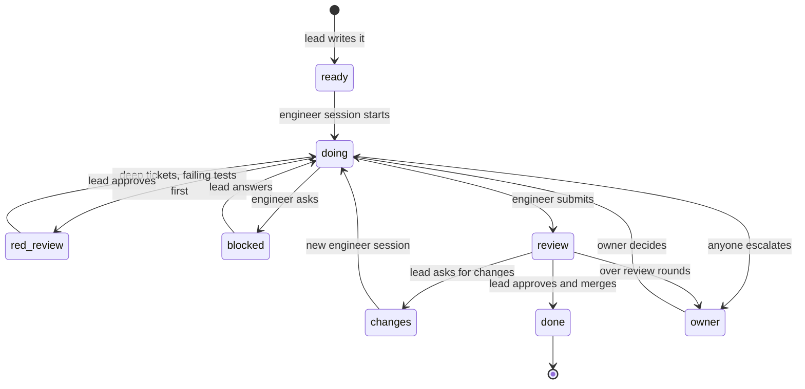

# How the agents work together

**In short:** agents never talk to each other. Each one does a small piece of work in a
short session, and records the result on a ticket in this repository. A script starts the
next agent. You see a one-line board, and hear from the project only when a decision is yours.

## Why this shape

Long conversations are what cost the most. In the 40 largest Codex sessions on this machine,
the top five used about 390M of 535M input tokens, because each turn re-sends the whole
context. Agents chatting would make that worse, and a person relaying between them is the
bottleneck you asked to remove.

Large engineering groups solved the same problem. They do not get everyone talking; they
limit who needs to talk, and they make the work itself the message.

| Practice | Where it comes from | What we use |
|---|---|---|
| Communication paths grow as n(n-1)/2, so limit them | Brooks, *The Mythical Man-Month* | Every agent talks only to the board |
| Work flows up a maintainer tree, and each area has an owner | Linux kernel | Engineer → tech lead → owner |
| Small changes get reviewed quickly and well | Google engineering practices | One ticket per session, with a size limit |
| "If it didn't happen on the list, it didn't happen" | Apache Software Foundation | If it is not on the ticket, it did not happen |
| Write a short document instead of holding a status meeting | Amazon narratives | The board and a short decision note |
| A decision has one owner | Amazon single-threaded owners | Each ticket has one owner at a time |
| Asynchronous by default | Open source generally | Nobody waits in a conversation |

## Who does what

| Role | Held by | Decides | Hears about |
|---|---|---|---|
| Owner | You | Priorities, milestones, anything outward-facing | Only the inbox and milestone reviews |
| Tech lead | Claude | Specs, reviews, technical answers, merging to local `main` | Tickets in `review`, `red-review` and `blocked` |
| Engineer | GPT, one fresh session per ticket | How to implement the ticket | Its one ticket |
| Dispatcher | `tools/dispatch.py`, no model | Nothing; it starts whoever is next | The board |

Engineers never see each other. If two tickets interact, the lead sets a dependency or
splits the work. As subsystems grow (backend, runtimes, tools), each gets a short brief in
`docs/components/`. More engineers can then run in parallel by raising `wip_limit`, as long
as their tickets do not touch the same files.

## How a ticket moves



The dispatcher reads the board without using any model, picks the next action and starts one
fresh session. It finishes open work before it starts new tickets.

## Rules that keep context small

1. **Agents do not message each other.** The only channel is the ticket. `tools/pm.py` is the only thing that writes to it.
2. **A session has one role and one ticket, and it ends when the state changes.** No session stays open to wait for anything. Follow-up work starts fresh.
3. **Read only what you need.** A session starts from its role's rules and its ticket, then opens the files that ticket points to. Nobody reads the whole plan to start work.
4. **Point to things; do not paste them.** Notes stay under 600 characters. Logs stay in files, and tickets link to them.
5. **Tickets stay short:** 80 lines for the brief. Lasting knowledge moves to the code, an ADR or a component brief.
6. **Two review rounds, then a person.** A third round of requested changes goes to the owner, because something is wrong with the ticket or the design.
7. **Escalate up, one level at a time.** Engineer asks the lead. The lead answers or escalates to the owner.

## What you see

You should not have to ask anyone for an update. `STATUS.md` updates itself at every ticket change, a
Windows notification appears when a ticket finishes or needs you, and each session ends with a one-line
`PM update:`.

## What you do

```bash
python tools/pm.py board
```

```bash
python tools/pm.py inbox
```

```bash
python tools/dispatch.py --max-sessions 6
```

**One setup step:** the dispatcher starts Claude reviews through Claude's command line, which
needs its own login. Run it once, and type `/login` in the session that opens:

```powershell
& (Get-ChildItem "$env:LOCALAPPDATA\Packages\*Claude*\LocalCache\Roaming\Claude\claude-code\*\*\claude.exe" | Sort-Object LastWriteTime | Select-Object -Last 1).FullName
```

Until then, the dispatcher stops at reviews without changing the ticket. You can also open a
Claude session and ask it to act as tech lead on the board.

- `board` shows all tickets in one line each, and what is next.
- `inbox` shows only what needs you. Answer with `PM_ROLE=owner python tools/pm.py decide <ID> "<decision>"`.
- `usage` shows tokens per ticket, and `python tools/storage.py` shows disk use.
- Agents commit and merge locally. They never push. Pushing stays yours.
- You can read a ticket or any session whenever you like, but nothing depends on you relaying it.

## Parallel work between agents

Engineers work in separate git worktrees, in `.work/<ticket>`, on their own branches.
The ticket files change only on `main`, through `tools/pm.py`, which runs from any worktree.
The lead reviews a branch with `git diff main...<branch>`, so nothing needs to be copied.

## Sources

- [Linux kernel: how the development process works](https://docs.kernel.org/process/2.Process.html)
- [Google: small changes](https://google.github.io/eng-practices/review/developer/small-cls.html)
- [Google: the standard of code review](https://google.github.io/eng-practices/review/reviewer/standard.html)
- [Codex hooks](https://learn.chatgpt.com/docs/hooks), [rules](https://learn.chatgpt.com/docs/agent-configuration/rules) and [non-interactive mode](https://learn.chatgpt.com/docs/non-interactive-mode)
