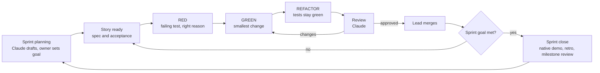

# Development cycle

Agile delivery with test-driven development, adapted to a compiler project that has
one shared test card. GPT implements. Claude specifies and reviews. The owner decides.
Who talks to whom is in [COLLABORATION.md](COLLABORATION.md), and the cost limits are in
[HARNESS.md](HARNESS.md).

**Keep it light.** Everything here has to earn its place: one evidence note per story,
no routine receipts, no test projects for housekeeping. If a step stops helping, cut it
at the next retro.

## 1. The cycle at a glance

## 2. Cadence

| Event | When | Who | Output |
|---|---|---|---|
| Sprint planning | Start of sprint | Claude drafts, owner approves | `docs/sprints/SPRINT-NN.md` with one goal, and tickets in `work/tickets/` |
| Work session | When the dispatcher starts one | GPT | One fresh session on one ticket |
| Story review | When a ticket is submitted | Claude | Approve, or numbered findings, on the ticket |
| Consult | When blocked | GPT asks, Claude answers | Reduced reproducer plus question, on the ticket |
| Sprint close | Goal met, or at the two-week cap | All | Native demo, metrics, three-line retro, milestone review if due |

Sprints end when the goal is met. There are no waiting periods. If the cap arrives first,
the unfinished stories return to the backlog and the sprint closes honestly as missed.

Limit work in progress to **one story per implementation session**. A story should fit in
one session and change roughly 500 lines or fewer, excluding generated files. Split it
if it does not.

## 3. Story lifecycle

**Definition of Ready.** Claude confirms before work starts:

- The behaviour is written as an observable outcome, and acceptance criteria name the tier and the oracle
- Dependencies are done, and the review depth is set
- Any ISA or ABI facts are cited (section or probe)

**Steps**, each as its own commit:

1. **RED** — `test(S1-03): ... [red]`. Add tests only and run them. The evidence note shows the failure and why it is the *expected* failure. A test that fails for the wrong reason, such as a build error in the test itself, is not red.
2. **GREEN** — `feat(S1-03): ...`. Make the smallest change that passes the test.
3. **REFACTOR** — `refactor(S1-03): ...`. Optional; all tests stay green.
4. **Evidence note**, one short `submit` note on the ticket: what ran, tier, pass counts, card minutes, and the log path for anything longer.

Tools and non-code stories follow the same pattern with the appropriate test. Research
stories have no red step; their acceptance criterion is a reviewed conclusion.

**Definition of Done:**

- [ ] All acceptance criteria are met at the named tiers, and native tiers have really run on the card
- [ ] Red-then-green is visible in the history
- [ ] `tools/knc_lint` is clean, and the regression ratchet shows no new failures
- [ ] Any new `xfail` or skip has a linked backlog item and a reason
- [ ] Rationale and sources are in the commit message or adjacent comments
- [ ] Claude approved and merged

## 4. Test tiers

The tiers are what make TDD workable here: most of the loop runs without the card.

| Tier | What it proves | Where | Budget | When |
|---|---|---|---|---|
| **T0** | Tools and harness logic work | Host | < 1 min | Every change |
| **T1** | Target-pattern, dump and optimization expectations; assembles for `k1om`; ISA lint clean | Host | ≤ 5 min with rebuild | Every change |
| **T2** | Links; ELF machine 181; loader; symbol versions; no undefined symbols; lint over linked objects, runtimes included | Host | < 5 min | Every change touching link or runtime |
| **T3** | Native execution of the story's tests and acceptance fixtures | Card, not exclusive | ≤ 10 min | Before review of anything that affects semantics |
| **T4** | Native GCC testsuite subsets through a DejaGnu board | Card, not exclusive | Hours; batched | Sprint close, and on demand |
| **T5** | Kernel performance: matched repeats, thermals recorded | Card, **exclusive** | Scheduled | Stories that claim a performance result; milestone reviews |
| **T6** | Corpus program builds and matched runs | Card, **exclusive** | Owner-approved | Milestones M3, M4 and M5 |

## 5. TDD rules for compiler work

**A code-generation story normally needs two tests:** a T1 test that the intended code is
emitted, and a T3 test that it computes the right answer. Pattern matching alone can pass
on wrong code, and execution alone can pass without vectorizing.

- **Defeat the optimizer deliberately.** Feed inputs at runtime, put loops in a separate translation unit, keep outputs observable. A constant-folded result proves nothing.
- **Prefer specific scans.** Scan for `vfmadd231ps.*zmm` in the named function, not `zmm` anywhere in the file.
- **Include the negative.** Every positive vectorization test gets a legality twin that must *not* transform, such as a dependent loop. Likewise tests for no `xmm`, `cmov` or `vmovups`.
- **Boundaries are the default.** Exercise lengths around lane counts, every offset within a cache line, and arrays flush against a guard page.
- **Check the failure mode.** Before review, seed a bug once (a wrong pattern or a dropped mask) and confirm the test catches it. Note this in the evidence.
- **An ICE gets a reduced reproducer first.** That reproducer becomes the red test.
- **A native-only red is allowed.** If a T3 test cannot run yet because the card is busy, the story stays in progress. It is not done until T3 has actually run.

### Oracles

The implementer writes both code and story tests, so expected values must come from
something independent of the code under test:

| Oracle | Use for |
|---|---|
| Exactly representable inputs and results | Lowering tests where excess precision and FMA must not matter (the M1 fixture) |
| Closed-form results | Integer and memory behaviour, masks, permutes |
| Donor GCC 5.1.1 object in the same link | ABI cross-checks; scalar references |
| MPFR or SoftFloat, generated on the host, vectors shipped to the card | Math, division, conversions |
| ISA manual pseudo-code, hand-derived | Instruction semantics |
| Hand-written IMCI reference kernels, written for this project | Performance comparison only |

x87 output is not a general oracle for vector FP, because excess precision can
legitimately change results. Host execution here means test-vector generation or
fixture logic. It is never a substitute for the card.

### Regression ratchet

From the first T4 baseline, GCC `.sum` files are compared using `contrib/compare_tests`.
A new `FAIL` blocks merging. Unexpected passes are reviewed, and the baseline moves only
in a reviewed commit. Keep `XFAIL` and `UNSUPPORTED` visible and counted, and do not use
them to hide a real gap.

## 6. Who owns which tests

| Path | Owner | Rule |
|---|---|---|
| `tests/acceptance/` | Claude | GPT runs them but does not edit them. A suspected fixture bug is raised, not worked around |
| `tests/regress/`, GCC testsuite additions | GPT | Reviewed with the story |
| `tests/tools/` | GPT | T0 tests of the tooling |

## 7. Review protocol

Review depth is set per story at planning, so Claude's limited budget goes to what is hard
to undo.

| Depth | Applies to | What happens |
|---|---|---|
| **Deep** | ABI, calling convention, FP semantics, register allocation and reloads, default option changes, runtime contracts, milestone reviews | Claude approves the spec *and* the red tests before GREEN starts, then does a full diff review |
| **Standard** | New patterns, expanders, cost changes | Claude reviews tests and diff once GREEN and T3 are done |
| **Light** | Tools, docs, refactors with no output change | Batched at sprint close |

**Reviewers check, in order:**

1. Do the tests prove the acceptance criteria, and could they fail? Was the red real?
2. Is it correct at the boundaries: lanes, masks, alignment, faults, FP state, exceptional values?
3. Is the legality right? Do transformations respect dependence and the FP contract?
4. Does it hide a cost, such as hidden spills or helper calls that look cheap to the optimizer?
5. Does it follow the ADRs? Is the shared-file change as small as possible? Are provenance and sources recorded?

**Verdict:** `tools/pm.py approve`, or `tools/pm.py changes` with numbered findings, each with
`file:line`. Over-testing and needless validation count as findings, and the fix is to
delete them. Claude reviews the evidence, then reruns only what looks doubtful. GPT resolves findings with new commits and does not rewrite the reviewed
history.

### Handoff

Nobody relays anything. The dispatcher starts the review when a ticket is submitted,
and the lead reads the branch directly. See [COLLABORATION.md](COLLABORATION.md).
**Agents never push.** The lead merges approved work to local `main`.

## 8. Consulting and escalation

GPT stops and asks when any of these is true:

- **Two real attempts failed** on the same problem. Provide a reduced reproducer, the dumps that matter and the question.
- A change would need an ADR to change, a fixture to change, or a new milestone exit criterion.
- A change touches a shared i386 path broadly, or needs an SSE or AVX flag to be true.
- A native result contradicts the ISA manual.

GPT does not widen the scope, weaken a test, or relabel a failure to keep moving.

Claude escalates to the owner for decisions in the plan's list, anything outward-facing,
or when a milestone threshold is in question.

## 9. Card discipline

There is one card, and it may also be used by unrelated work on this machine. All access
goes through `tools/card_run`, which does the following:

1. Refuses to run if a foreign job is on the card: any configured external lock file is present, or foreign processes are running. It never touches them. Today's one external lock is `PhiWeather/artifacts/test-state/g5-narrow14/native-session.lock`, kept only because that app can use the same physical card.
2. Runs in a private temporary directory, with a time limit, and cleans up afterwards.
3. Records the boot ID and the card minutes used. A reboot wipes `/var/volatile/tmp`, so the runner restores what it needs and does not treat a reboot as a test failure.

- Batch T3 and T4 runs. Run them when a story is otherwise ready, not on every edit.
- T5 and T6 runs are exclusive and thermally recorded; no other card job overlaps them.
- Do not install system files on the card.
- Failures caused by the card state are infrastructure failures, reported as such. They are not retried silently, and they are not counted as test passes.

## 10. Performance claims

- A number is a claim only if it names the compiler commit, options, inputs, thread density, working set and clock boundaries.
- Screening uses matched runs. A speedup claim needs repeats, and setup costs count when the application pays them.
- Kernel gains are not added to one another or projected onto whole programs without the §13 model from the report.
- No tuning rule may be justified by a single program. Check it against the wider corpus, including held-out programs.
- Negative results are kept on the ticket. They are useful, and they should not be rerun unchanged.

## 11. Documentation weight

| Kind | Place | Rule |
|---|---|---|
| Current truth | `CURRENT_STATE.md` | One page; replace lines rather than appending history |
| Sprint goal and retro | `docs/sprints/` | One short file per sprint |
| Working record | `work/tickets/` | Brief, notes, questions and verdicts for one ticket |
| Lasting decisions | `docs/adr/` | Short; changed only by Claude or the owner |
| Research conclusions | `docs/research/` | Conclusion first, with sources and limits |
| Large outputs | Outside git | Build trees, dumps, `.sum` history and installs. Keep a small text summary |

Failed attempts are summarized on the ticket, and then their files are deleted.
